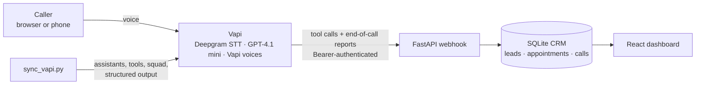

# AI Front Desk for Local Service Businesses

A working demo of the AI systems local service businesses pay for: an **AI receptionist that books jobs**, an **emergency dispatcher handoff**, **instant lead follow-up calls**, **dead-lead reactivation**, and an **AI-powered CRM dashboard**. It's built on [Vapi](https://vapi.ai) for a fictional plumbing & HVAC company, **Ridgeway Plumbing & Air**.

Every call runs in the browser, so anyone can try it without a phone number.

<!-- Screenshots: add images to docs/screenshots/ and embed them here (see docs/DEMO_SCRIPT.md for the shot list). -->

## What it does

| Business need | What's built | Where |
|---|---|---|
| **Never miss a call** | **Alex**, a receptionist who triages the problem, checks live availability, books an arrival window, and reads back a reference number | Front desk tab |
| **Handle emergencies safely** | A **Vapi Squad**: Alex gives the safety step (shut off the water, leave the house for gas), then hands off to **Jordan**, an emergency dispatcher with a different voice who logs the job for the on-call tech | Front desk tab |
| **Speed to lead** | A quote form that triggers **Sam**, who calls the lead back immediately, already knowing their name and problem, and books the visit | Get a quote tab |
| **Dead-lead reactivation** | **Taylor** calls past customers with a seasonal offer, books interested ones, honors do-not-call instantly, and leaves voicemails. It exports a ready-to-launch **Vapi Campaign** | Win-back tab |
| **AI CRM** | Every call is summarized and scored after it ends (booked, urgency, job type, sentiment, follow-up reason). The dashboard shows booking rate, estimated revenue, speed-to-lead, and a needs-attention queue | Dashboard tab |

## How it works



- **Agents as code.** Prompts live in `backend/vapi/prompts/*.md` and configs in `backend/app/agents/`. One idempotent script (`scripts/sync_vapi.py`) creates or updates every assistant, tool, credential, structured output, and squad in Vapi. Nothing is configured by clicking around the dashboard.
- **Tools are a real API.** Vapi calls the webhook to check availability, book appointments, log leads, and record outcomes. Each tool's input is a Pydantic model that both validates requests and generates the JSON Schema sent to Vapi, so they can't drift apart.
- **Post-call intelligence.** A Vapi Structured Output extracts the call outcome, and the end-of-call report is stored with summary, transcript, cost, and duration.

| Agent | Role | Tools |
|---|---|---|
| Alex (receptionist) | Inbound calls, booking, triage | check_availability, book_appointment, create_lead, handoff → Jordan |
| Jordan (dispatcher) | Emergencies only | create_lead |
| Sam (follow-up) | Calls web leads back instantly | check_availability, book_appointment, create_lead |
| Taylor (win-back) | Reactivation offer | check_availability, book_appointment, update_lead_status, voicemail |

## Engineering highlights

These were found by testing real calls and fixed at the root, with a regression test for each:

- **A handoff dropped the call.** Vapi asked the model to echo the dispatcher's UUID, and GPT-4.1 mini changed one character (`assistant-not-found`). Fix: address the squad member by name, with a **strict enum** argument so the model can't send anything else.
- **The AI said an emergency callback was "booked"**, which inflated booking rate and revenue. Fix: "booked" now comes from the CRM (an appointment exists for that call). The LLM's answer is kept for reference only.
- **The campaign export produced an invalid phone number** (`+5550127`). Fix: E.164 validation, and undialable numbers are excluded and reported, never sent.
- **Customer data was reachable through the public tunnel.** Only the Vapi webhook is public. Dashboard and CRM APIs reject proxied requests.

Other safeguards:
- **Trust boundary:** the win-back status tool reads the customer ID from the call's variables on the server. A test proves the model can't redirect it to another customer.
- **Idempotent bookings:** a retried tool call (same `toolCallId`) never double-books.
- **Consent and opt-outs:** the quote form requires consent before an automated call. Do-not-call, wrong-number, and already-booked leads are never re-dialed or exported.
- **Spend control:** a small model, short replies, a silence timeout, and chat-mode simulations.

## Testing

- **62 backend tests** (`uv run pytest`): auth, every tool, validation errors, duplicate deliveries, full time windows, call logging, KPI math, the tunnel guard, the trust boundary, and phone formatting.
- **8 Vapi Simulations** in 2 suites. An AI tester plays realistic callers (cooperative, stressed, skeptical) against the real agents, with every tool mocked. **8/8 passed, 21/21 checks.** See [`backend/simulations/RESULTS.md`](backend/simulations/RESULTS.md).
  - Covered: booking, filled-window recovery (never falsely confirms), burst-pipe handoff, gas evacuation before questions, no invented prices, honest AI disclosure, opt-out honored, win-back booking.
  - Limits: these are chat runs with one iteration. Voice runs and repeated runs are the next step before production.

## Run it locally

**Prerequisites:** Python 3.11+ with [uv](https://docs.astral.sh/uv/), Node 20+, a [Vapi](https://dashboard.vapi.ai) account, and [ngrok](https://ngrok.com) (free) so Vapi can reach your webhook.

```bash
# 1. Backend config
cd backend
cp .env.example .env        # add your Vapi private + public keys and a random webhook secret
uv sync
uv run python -m scripts.sync_vapi --check

# 2. Public URL for the webhook (separate terminal), then set PUBLIC_BASE_URL in .env
ngrok http 8000

# 3. Create everything in Vapi, then seed demo data
uv run python -m scripts.sync_vapi
uv run python -m scripts.seed_db
uv run python -m scripts.seed_old_leads

# 4. Run the API
uv run fastapi dev app/main.py

# 5. Frontend (separate terminal)
cd ../frontend
cp .env.example .env.local
npm install
npm run dev                 # http://localhost:5173
```

Useful scripts (run from `backend/`):

| Command | What it does |
|---|---|
| `uv run pytest` | Backend test suite |
| `uv run python -m scripts.run_simulations sync \| run \| report` | Vapi Simulations: create, run, write results |
| `uv run python -m scripts.backfill_calls [--extract]` | Import past calls from Vapi, optionally analyze them |
| `uv run python -m scripts.export_campaign` | Dry-run Vapi Campaign export (CSV + `POST /v2/campaign` body) |
| `uv run python -m scripts.show_crm` | Quick look at leads and appointments |

**Cost:** the voice test calls made during the build cost **$0.02–$0.18 each** (16 seconds to 2½ minutes), **about $0.52 in total**. Chat simulations use model tokens only; check the Vapi dashboard for their cost.

## Project structure

```
backend/
  app/
    agents/        Vapi resource definitions (assistants, tools, squad, structured output)
    controllers/   Request handling (webhook, CRM, quote, win-back)
    routers/       FastAPI routes
    schemas/       Pydantic models (tool arguments double as Vapi JSON Schemas)
    services/      Scheduling, CRM, call logging, pricing, phone formatting, Vapi client
    db/            SQLAlchemy models and session
  vapi/prompts/    System prompts, one Markdown file per agent
  simulations/     Vapi Simulation suites + latest RESULTS.md
  scripts/         sync_vapi, seeding, backfill, campaign export, simulations
  tests/           pytest suite
frontend/src/
  pages/           Home, Front desk, Get a quote, Win-back, Dashboard
  components/      Call panel, badges, KPI tiles, call detail drawer
  hooks/           useVapiCall (Vapi Web SDK), usePolling
```

## Deploy the demo (free tier)

The backend runs on **Google Cloud Run** (scales to zero, re-seeds fictional demo data on each fresh start) and the frontend on **Firebase Hosting**. Step-by-step guide: [`docs/DEPLOY.md`](docs/DEPLOY.md). `PUBLIC_DEMO=true` opens the dashboard deliberately and shows visitors a "fictional data" notice, while the Vapi webhook always requires its secret.

## Production checklist

This is a demo. Taking it to a real client would add:

- **Phone numbers:** a Twilio or Vapi number for inbound calls, plus an outbound-capable number for follow-up and Campaigns (free Vapi numbers can't run campaigns), and SMS for reactivation.
- **Hosting for a real client:** move SQLite to Postgres and **put real authentication on the dashboard**. The hosted demo is deliberately public with fictional data.
- **Lock down the Vapi public key** to the site's domain in Vapi → API Keys → Origins. Anyone with the key can start calls on your credit.
- **Integrations:** connect the client's real calendar and CRM (Google Calendar, Jobber, ServiceTitan, GoHighLevel) in place of SQLite scheduling.
- **Confidence:** voice-mode simulations, repeated runs of the critical scenarios, and a human review of call recordings.
- **Compliance:** confirm consent, calling hours, caller ID, and recording disclosure for each region.
